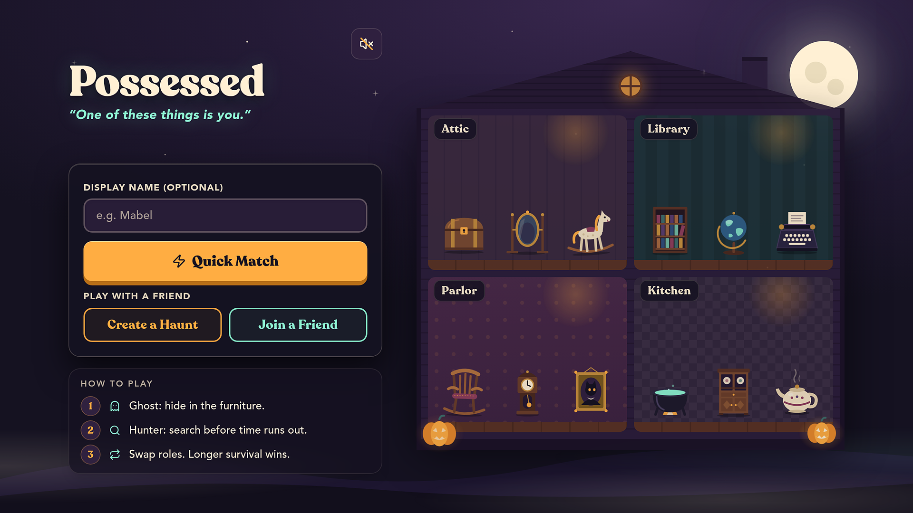
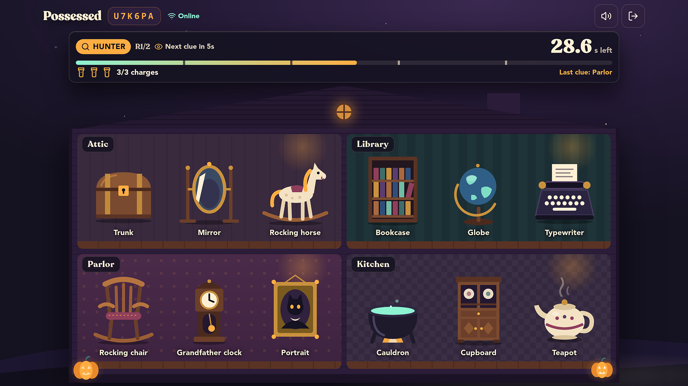
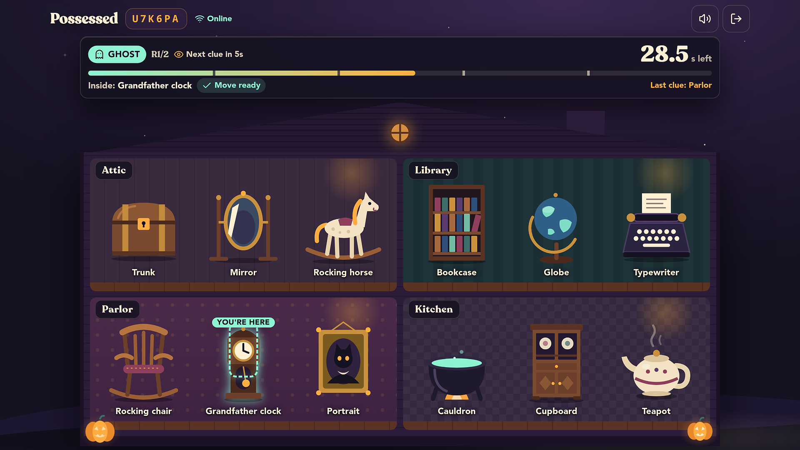
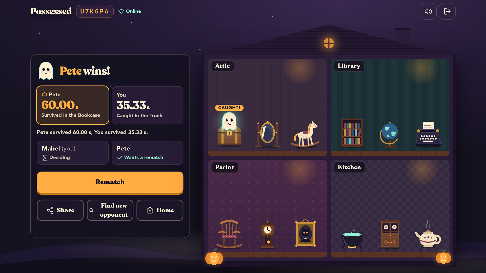

# POSSESSED

### One house. Two players. Trust nothing.

**[PLAY POSSESSED](https://possessed.base44.app)** &nbsp; / &nbsp; **[CONTEST & VOTING](https://app.base44.com/launchpad/contests/spooky-showdown)** &nbsp; / &nbsp; [How to play](#how-to-play)

Indica Independent Media's entry in **Base44 Spooky Showdown**.

**Live source: [github.com/indicaindependent/possessed-source](https://github.com/indicaindependent/possessed-source)** (the builder-synced repository, always the latest). This repository is the curated showcase of it.

A real-time, two-player game of supernatural hide-and-seek. One player hides inside the house's objects as the Ghost. The other follows clues and spends search charges as the Hunter. Then the roles reverse.

**Quick Match:** one tap and you are paired automatically with another waiting player. Prefer to play with someone you know? Create a haunt and send them its private invite link.

Staged sample match, rendered from source revision <code>e52739d7</code> with the project's own test fixtures (players Mabel and Pete). Not live play.

| Be the Ghost | Be the Hunter |
| :--- | :--- |
| Hide in plain sight. Move between objects. Make your friend doubt the room. | Read the clues. Choose your searches. Catch the presence hiding in the furniture. |

**Play together, then trade places.** Both players get a turn on each side of the haunting.

Enjoyed the game? Visit the [Spooky Showdown contest page](https://app.base44.com/launchpad/contests/spooky-showdown) to follow the competition and its community voting. Votes are cast on Base44, not through GitHub stars.

---

## How to play

1. Press **Quick Match** to be paired automatically with another waiting player, or create a haunt and send a friend its private invite link or room code.
2. Join from another browser or device. Both players select Ready.
3. As the Ghost, move between objects and survive for up to 60 seconds.
4. As the Hunter, investigate objects and follow periodic room clues.
5. Swap roles for round two. Longer Ghost survival wins; equal survival times draw.

Four rooms contain twelve hiding places. The Ghost has an eight-second cooldown between moves. The Hunter starts with three charges and regenerates one spent charge every five active seconds. Room clues arrive at 12, 24, 36 and 48 seconds. These are the configuration values in this source snapshot, not claims of perfect balance.

## What is inside

- **Authoritative server.** The `HauntRoom` Actor (`base44/actors/HauntRoom/entry.ts`) owns the shared game state, so clients cannot decide outcomes for themselves.
- **Matchmaker.** The `Matchmaker` Actor (`base44/actors/Matchmaker/entry.ts`) runs the Quick Match pairing queue and reports live counts of players online and searching.
- **Rules engine.** `base44/shared/possessedEngine.ts` holds the match and round rules; balance values live in `possessedConfig.ts`.
- **Tests.** 54 tests across 6 files run under Vitest: rules, Actor simulation, acknowledgements, room links and the matchmaker.
- **Procedural soundtrack.** `src/lib/possessed/music.js` synthesizes a slow, slightly-off music-box waltz in D minor live in the browser, 16 bars at 80 bpm, from oscillators with an echo. It uses no audio files and no external URLs, so it is original and carries no licensing risk.
- **Sound and ambience.** Every sound, including the creaks and haunt ambience on the home and waiting screens, is synthesized in the browser by `src/lib/possessed/audio.js` and `creak.js`, with no audio files and no external URLs. The music tries to start on load; browsers that block autoplay (Safari on iPhone) start it on the first tap, and a speaker toggle on the home screen mutes it.

## Design and polish

The latest builder commits refined the mobile layout and typography and added a shared set of design tokens in `src/index.css`: a palette of ink, plum, pumpkin, spectral green and parchment, plus a text scale and line-height steps, so spacing and type stay consistent across the lobby, the house and the result screens.

## Architecture

- React frontend with Vite and Tailwind CSS.
- Base44 Actor `HauntRoom` owns shared multiplayer state.
- Base44 Actor `Matchmaker` pairs players who press Quick Match and reports how many are online and searching.
- Shared server-side rules govern scoring, moves, searches, clues and reconnect grace.
- Player-specific messages separate private Ghost information from Hunter-visible state.
- SVG prop artwork, browser audio and bundled app icons.

## Source map

| Path | Purpose |
|---|---|
| `base44/actors/HauntRoom/entry.ts` | Authoritative multiplayer Actor |
| `base44/actors/Matchmaker/entry.ts` | Quick Match pairing queue and live counts |
| `base44/shared/possessedEngine.ts` | Match and round rules |
| `base44/shared/possessedConfig.ts` | Balance values and object definitions |
| `src/components/possessed/` | Game views, rooms, props and artwork |
| `src/lib/possessed/` | Client connection, session, audio, music and interaction logic |
| `tests/` | Rule, Actor simulation, acknowledgement and reconnect tests |
| `public/icons/` | Bundled PNG icons |

## Development

This is a source snapshot, not a connection to the original game's production environment. The builder syncs to [possessed-source](https://github.com/indicaindependent/possessed-source); this showcase does not sync with Base44 and changes here do not edit or deploy the live game. Do not point experimental work at production data.

The frontend relies on Base44 services, including Actors. A static web host alone is not a replacement for the authoritative backend. Consult the [Base44 local development documentation](https://docs.base44.com/developers/backend/overview/local-dev/local-development-overview) when setting up your own environment.

Install the locked dependencies with `npm ci`, build with `npm run build`, and lint with `npm run lint`. Run the tests with `npx vitest@3 run` (Vitest is not a project dependency; `vitest.config.js` maps the Actor runtime to a test mock).

Never put a credential into a `VITE_` variable: frontend build variables are public. Keep local credentials and linked-app files out of version control.

## Verification and limitations

Source refreshed from the builder-synced repository on 2026-11-01 (revision `e52739d7`, adding autoplay audio with a sound toggle and home and waiting-room ambience on top of the soundtrack, the mobile design-token pass and Quick Match). All 54 tests pass across 6 files, and `npm run build` succeeds after a clean `npm ci`. The lockfile resolves Zod 4.6.7. See [source provenance](docs/SOURCE.md) for the imported revision and what this public snapshot includes.

The standalone build warns that `VITE_BASE44_APP_ID` is unset; this verifies compilation, not a configured deployment. Automated tests use a simulated Actor runtime and are not equivalent to real-device multiplayer testing. The owner previously reported successful phone-and-desktop gameplay testing; that is separate from these automated checks. No new live multiplayer play-through or clean-security-audit claim is made for this refresh.

## License

MIT. See [LICENSE](LICENSE).
