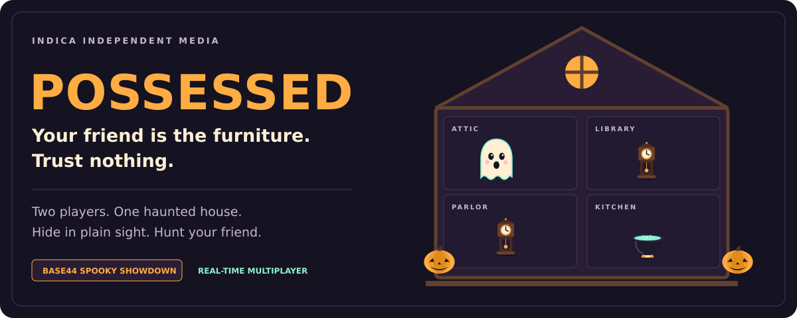
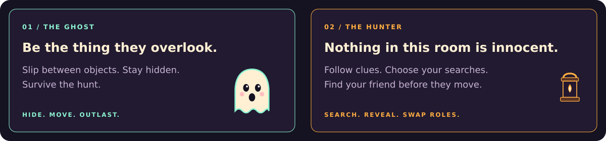

# POSSESSED

### One house. Two players. Trust nothing.

**[PLAY POSSESSED](https://possessed.base44.app)** &nbsp; / &nbsp; **[CONTEST & VOTING](https://app.base44.com/launchpad/contests/spooky-showdown)** &nbsp; / &nbsp; [How to play](#how-to-play)

Indica Independent Media's entry in **Base44 Spooky Showdown**.

A real-time, two-player game of supernatural hide-and-seek. One player hides inside the house's objects as the Ghost. The other follows clues and spends search charges as the Hunter. Then the roles reverse.

Bring a friend. Create a haunt. Share the room code.

| Be the Ghost | Be the Hunter |
| :--- | :--- |
| Hide in plain sight. Move between objects. Make your friend doubt the room. | Read the clues. Choose your searches. Catch the presence hiding in the furniture. |

**Play together, then trade places.** Both players get a turn on each side of the haunting.

Enjoyed the game? Visit the [Spooky Showdown contest page](https://app.base44.com/launchpad/contests/spooky-showdown) to follow the competition and its community voting. Votes are cast on Base44, not through GitHub stars.

---

## How to play

1. Create a haunt and share its room code with a friend.
2. Join from another browser or device. Both players select Ready.
3. As the Ghost, move between objects and survive for up to 60 seconds.
4. As the Hunter, investigate objects and follow periodic room clues.
5. Swap roles for round two. Longer Ghost survival wins; equal survival times draw.

Four rooms contain twelve hiding places. The Ghost has an eight-second cooldown between moves. The Hunter starts with three charges and regenerates one spent charge every five active seconds. Room clues arrive at 12, 24, 36 and 48 seconds. These are the configuration values in this source snapshot, not claims of perfect balance.

## Architecture

- React frontend with Vite and Tailwind CSS.
- Base44 Actor `HauntRoom` owns shared multiplayer state.
- Shared server-side rules govern scoring, moves, searches, clues and reconnect grace.
- Player-specific messages separate private Ghost information from Hunter-visible state.
- SVG prop artwork, browser audio and bundled app icons.

## Source map

| Path | Purpose |
|---|---|
| `base44/actors/HauntRoom/entry.ts` | Authoritative multiplayer Actor |
| `base44/shared/possessedEngine.ts` | Match and round rules |
| `base44/shared/possessedConfig.ts` | Balance values and object definitions |
| `src/components/possessed/` | Game views, rooms, props and artwork |
| `src/lib/possessed/` | Client connection, session, audio and interaction logic |
| `tests/` | Rule, Actor simulation, acknowledgement and reconnect tests |
| `public/icons/` | Bundled PNG icons |

## Development

This is a source snapshot, not a connection to the original game's production environment. A separate repository does not automatically sync with Base44. Do not point experimental work at production data.

The frontend relies on Base44 services, including Actors. A static web host alone is not a replacement for the authoritative backend. Consult the [Base44 local development documentation](https://docs.base44.com/developers/backend/overview/local-dev/local-development-overview) when setting up your own environment.

Install the locked dependencies with `npm ci`, build with `npm run build`, and lint with `npm run lint`. Run the tests with `npx vitest@3 run` (Vitest is not a project dependency; `vitest.config.js` maps the Actor runtime to a test mock).

Never put a credential into a `VITE_` variable: frontend build variables are public. Keep local credentials and linked-app files out of version control.

## Verification and limitations

Source refreshed from the builder-linked repository on 2026-10-30. All 44 tests pass across 5 files, and `npm run build` succeeds after a clean `npm ci`. The lockfile resolves Zod 4.6.7. See [source provenance](docs/SOURCE.md) for the imported revision and what this public snapshot includes.

The standalone build warns that `VITE_BASE44_APP_ID` is unset; this verifies compilation, not a configured deployment. Automated tests use a simulated Actor runtime and are not equivalent to real-device multiplayer testing. The owner previously reported successful phone-and-desktop gameplay testing; that is separate from these automated checks. No new live multiplayer play-through or clean-security-audit claim is made for this refresh.

## License

MIT. See [LICENSE](LICENSE).
